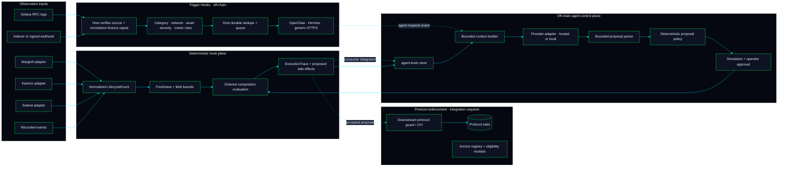

# Architecture

Agent Hooks is split into a deterministic hook plane and an off-chain agent control plane. Adapters normalize observations; the runtime validates, evaluates, and traces hooks; a protocol integration must enforce accepted decisions before mutating protocol state. Brains can retain those traces alongside later outcomes so planners can use operational history without becoming transaction authorities.



## Workspace layers

| Layer | Current responsibility | Boundary |
|---|---|---|
| `@agent-hooks/contracts` | Protocol-independent normalized lifecycle event and position/market snapshot types. | Contains no protocol client or orchestration dependencies; current event variant is the Solana lending schema. |
| `@agent-hooks/adapter-core` + protocol adapters | Lending adapter interfaces, shared pool metrics, and read pool/account snapshots for Marginfi, Kamino, and Solend. | Built on the contract package; current adapters are read-oriented and do not intercept every live protocol lifecycle transaction. |
| `@agent-hooks/sdk` | TypeScript composition, simulator, and executor-client interfaces using the shared contracts. | Its local simulator is not a protocol enforcement point. |
| `hook-runtime` | Rust event validation, ordered hook evaluation, bounded side-effect proposals, audit traces, and historical simulation. | It evaluates local Rust `Hook` implementations; side effects are proposals until a host applies them. |
| `agent-brain` | Storage interface with bounded in-memory and PostgreSQL implementations for normalized lifecycle events and hook feedback; query or stream prior experience to a planner. | Depends only on shared contracts, not adapters or the orchestration SDK. PostgreSQL uses an injected host database client; provenance labels remain caller-reported and are not cryptographically verified. No automatic reward attribution, causal model, or model training. |
| `agent-runtime` | Provider-neutral proposal contract, bounded runtime parser for model output, policy validation, and content-bound approval. | Parsing validates shape; policy validates allowed actions. Neither supplies a model provider, simulation engine, authenticated identity provider, wallet, or signer. |
| `@agent-hooks/toolkit` | Standalone TypeScript hook engine, bounded memory, daily X workflow, and treasury review queue. | Local workflow primitives only; production hosts provide durable stores, identity authentication, chain adapters, and execution services. |
| `@agent-hooks/trigger-hooks` | TypeScript Solana log/webhook ingress, deterministic trigger matching, expiring PostgreSQL claim store, and outbound OpenClaw, Hermes Generic V2, or generic HTTPS dispatchers. | Off-chain wake adapters only. Host owns protocol decoding/source verification, durable cursor/queue, agent-host configuration, retries, and all signing/execution boundaries. |
| Anchor executor | Pool/composition registration, eligibility receipts, and hook listing metadata. | `run_composition` does not CPI into registered hook programs, enforce their decisions, or mutate downstream protocol state. |
| Anchor policy example | A standalone policy instruction with bounded inputs and executor-PDA authorization. | A downstream protocol must call it before its own mutation and bind the checked values to that exact action; this sample is not itself a swap executor. |

### Trigger-to-agent path

Trigger Hooks is an off-chain wake-up path, not an on-chain callback or a Solana program. `SolanaLogSource` can subscribe to logs for a configured program; an indexer can instead POST observations through the signed-ingress helper. In both cases the host must fetch/reconcile chain data, authenticate relevant programs and accounts, decode protocol-specific events, and only then assert that an observation is verified. Predicates can match the resulting event, adapter, or LTV range.

The TypeScript package currently supplies outbound HTTP dispatch to OpenClaw's hook endpoint and Hermes Generic V2 webhook routes, plus a generic signed/bearer-authenticated HTTPS webhook. Alert rules can match built-in finance categories, host-defined network labels and metrics, asset symbols, severity, and existing lending lifecycle fields. These are predicates over data provided by the host; this repository does not include EVM/Bitcoin listeners, price feeds, whale detectors, or DAO decoders. The adapters hand the event to an operator-configured agent host. An optional PostgreSQL claim store handles atomic dedupe and expired-lease recovery, but there is no bundled durable source cursor or delivery queue: production hosts still own replay, queueing, retry, idempotency, and observability. See the [Trigger Hooks guide](trigger-hooks.md) for setup and deployment boundaries.

## Extending beyond Solana

`@agent-hooks/contracts` currently describes the Solana lending lifecycle, not a universal blockchain event schema. Do not place an EVM block number or Bitcoin height into its `slot` field. A chain-specific source should retain its native network, block, transaction, and finality identifiers, verify reorganizations and source accounts, then emit a versioned adapter event for the agent workflow. Keep EVM log decoding and UTXO/script interpretation in their own packages; do not hide incompatible semantics behind one generic field. See the [chain integration map](chain-integrations.md) for current support and the proposed host boundary.

For financial agents, waking on a liquidation-risk threshold, large transfer, or governance event can replace continuous polling with event-driven review. The wake is only a signal: it does not attest to a protocol decoder, guarantee delivery or response time, authorize a trade, or provide a safe signing path. Keep analysis and proposal generation separated from policy checks, simulation, operator approval, and transaction execution.

## Model-to-proposal path

The application owns the model provider and context builder. It selects and bounds source-attributed evidence, sends it to a hosted or local model, and passes the response to `parseAgentProposalOutput()` before calling `validateProposal()`. The parser rejects malformed, oversized, unsupported, or unbounded output; the policy rejects disallowed actions and missing approval or simulation requirements. A simulation result and an authenticated operator decision must be recorded by the application before its separately controlled execution service considers a mutation. See the [model integration guide](model-integration.md) for the code path and the [proposal contract](../packages/agent-runtime/README.md).

Treat retrieved memories, public social posts, token metadata, and RPC/indexer payloads as untrusted data in the model context. Their text cannot change policy. A caller-reported provenance label does not verify chain truth, and a parser or proposal approval does not grant signer authority.

## Deterministic evaluation path

An adapter or replay source produces a `LifecycleEvent`. A caller supplies a trusted `ExecutionContext.current_slot`; the runtime does not treat the event's own slot as the live clock. `EventValidationPolicy` bounds staleness, payload size, oracle observations, confidence, LTV, and basis-point fields. The host must authenticate source programs and oracle account ownership before constructing the normalized event: shape and range validation cannot prove provenance.

`Composition` orders up to eight local hooks by priority. Lifecycle flags decide whether a hook is called. The runtime enforces capability flags for rejection and side effects, checks LTV/rate/delay bounds, bounds instruction payloads, and fails closed when an oracle-dependent hook has no observations. An `ExecutionTrace` retains each hook result. If any hook rejects or returns an unauthorized/out-of-policy decision, the composition is rejected and executable side effects are cleared.

The returned trace is evidence of local evaluation, not evidence that a chain transaction executed. A production protocol integration still needs an explicit trust path: validate the caller and accounts, invoke approved hook programs through bounded CPI interfaces, stop on rejection, and only then mutate protocol state. The current Anchor executor does not implement that path.

## Experience feedback loop

`agent-brain` accepts a normalized event and caller-supplied hook feedback. A consumer should keep simulation, operator judgment, submitted transactions, and confirmed/finalized outcomes distinguishable; only appropriately verified outcomes should inform a policy presented as on-chain performance. `AgentBrain.recall()` retrieves past records by protocol event, composition, outcome, hook, tag, time window, or caller-labeled chain evidence for an off-chain planner. `ExperienceFeedStore.readAfter()` provides bounded, ordered replay to workers that resume from a persisted ingestion cursor; consumers must make side effects idempotent because a crash can replay a page. The PostgreSQL implementation serializes sequence allocation with insertion to preserve cross-process cursor order. It does not train a model, establish causality, or prove that a prior decision caused an outcome.

```text
observe → validate → evaluate hooks → preserve trace → protocol integration executes
                                                     ↓
                  later verified outcome → experience store → planner proposal
                                                               ↓
                                                 simulation + policy + approval
```

## Solana-specific design

On EVM, Uniswap v4 can encode hook capabilities in contract-address bits. Solana addresses are derived from keys, so Agent Hooks stores declared flag bits in composition metadata rather than requiring hook authors to grind keypairs. Those bits are declarations, not a security boundary by themselves: the caller and executor must verify the registered program, account relationships, capabilities, and CPI result at the point of enforcement.

The current Anchor executor is a registry/receipt prototype. Its events are useful for indexing eligibility but must not be interpreted as hook execution receipts. See [the hook specification](hooks-spec.md), [security notes](security.md), and [deployment status](deployment.md) before treating an example as production enforcement.
